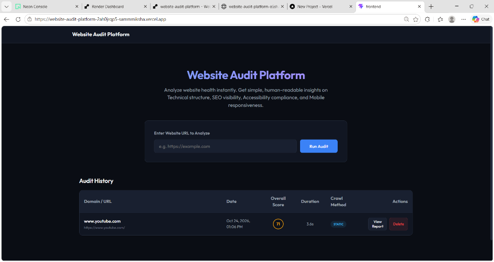

<div align="center">

# 🔍 Website Audit Platform

**Analyze any website's technical health, SEO readiness, accessibility, and mobile responsiveness — in seconds.**

[](https://website-audit-platform-2ah0jrqp5-sammmiksha.vercel.app/)

👉 **[Launch Live Website Audit Platform (frontend)](https://website-audit-platform-2ah0jrqp5-sammmiksha.vercel.app/)** 👈

<br/>


<br/>



</div>

---

## 📌 What It Does

Paste a URL, get a full website health report — instantly.

Website Audit Platform crawls a site and runs it through four specialized audit engines, then generates a scored, human-readable report covering what's working, what's broken, and how to fix it. No configuration, no accounts, just a URL.

- 🌐 **Live Demo:** [https://website-audit-platform-2ah0jrqp5-sammmiksha.vercel.app/](https://website-audit-platform-2ah0jrqp5-sammmiksha.vercel.app/)

---

## 🖥️ Live Dashboard Preview

<div align="center">
  
</div>

---

## ⚙️ How It Works

```
URL Input
   │
   ▼
Crawler Engine (Fast Static Analysis → Playwright Chromium for SPAs)
   │
   ▼
Content Extraction
(Title, Meta Description, Headings, Links, Images, Robots.txt, Sitemap)
   │
   ▼
Audit Engines
   ├── 🛡️ Technical Health (HTTPS, speed, response codes, page weight, broken links)
   ├── 🔎 SEO Analysis (Title, description, heading hierarchy, indexing files)
   ├── ♿ Accessibility (Alt tags, form labels, sequential heading levels)
   └── 📱 Mobile Responsiveness (Viewport tag, responsive units, legacy plugins)
   │
   ▼
Scoring Engine (0–100 per category + Overall Website Health Score)
   │
   ▼
Interactive Report Dashboard (Actionable Fixes + Highlights + Audit History)
```

**Crawling Strategy** — A two-tier approach:
1. **Static Crawl** (Requests + BeautifulSoup4) — Fast, lightweight, handles most static websites in seconds.
2. **Playwright Chromium Fallback** — Automatically triggered when client-side Single Page Application shells (React, Vue, Angular, Next.js) are detected.

---

## 📊 Audit Categories

<details open>
<summary><b>🛡️ Technical Health</b></summary>

| Check | Description |
|-------|-------------|
| HTTPS | Verifies secure TLS connection |
| Response Time | Measures server response and page load speed |
| Page Size | Evaluates total resource weight |
| Broken Links | Samples homepage links to detect broken 400+ status codes |
| Resource Count | Audits external stylesheets and script tags |

</details>

<details open>
<summary><b>🔎 SEO Readiness</b></summary>

| Check | Description |
|-------|-------------|
| Title Tag | Presence and optimal length (10–70 chars) |
| Meta Description | Presence and length (50–160 chars) |
| H1 Structure | Single, well-formed primary heading |
| Canonical URL | Canonical tag setup to prevent duplicate content |
| Robots.txt | Crawler instructions detection |
| Sitemap.xml | XML sitemap availability for search indexers |

</details>

<details open>
<summary><b>♿ Accessibility</b></summary>

| Check | Description |
|-------|-------------|
| Image Alt Text | Detects images missing screen-reader `alt` attributes |
| Heading Hierarchy | Verifies sequential heading progression without skipped levels |
| Form Labels | Ensures inputs are accompanied by descriptive `<label>` tags |
| Language Tag | Validates `lang` attribute on the `<html>` root |

</details>

<details open>
<summary><b>📱 Mobile Responsiveness</b></summary>

| Check | Description |
|-------|-------------|
| Viewport Meta Tag | Verifies `width=device-width` mobile scaling |
| Responsive Styling | Detects CSS media queries and flexible viewport units |
| Legacy Compatibility | Confirms absence of outdated plugins (Flash, Applets, Framesets) |

</details>

---

## 📈 Scoring System

Each category receives a score out of 100, weighted by issue severity. An overall health score is computed across all categories.

| Score Range | Rating | Status |
|:---:|:---|:---|
| **90–100** | Excellent ✅ | Meets modern web standards |
| **70–89** | Good 🟡 | Minor optimizations recommended |
| **50–69** | Needs Work 🟠 | Noticeable structural or SEO issues |
| **0–49** | Poor 🔴 | Critical fixes needed |

---

## 🛠️ Architecture & Tech Stack

| Layer | Technologies | Deployment Hosting |
|-------|-------------|-------------------|
| **Frontend** | React 19, Vite, React Router, Axios, CSS | **Vercel** (Global Edge CDN) |
| **Backend API** | Python 3.12, FastAPI, Uvicorn, Pydantic v2, SQLAlchemy | **Render** (Containerized with Docker) |
| **Crawling Engine** | Requests, BeautifulSoup4, Playwright (Headless Chromium) | Managed in Docker container |
| **Database** | Neon Serverless PostgreSQL (`psycopg` v3) / SQLite local fallback | **Neon** (Singapore ap-southeast-1) |

---

## 🚀 Getting Started Locally

### Prerequisites
- Python 3.12+
- Node.js 18+

### 1. Clone Repository
```bash
git clone https://github.com/sammmiksha/website-audit-platform.git
cd website-audit-platform
```

### 2. Backend Setup
```bash
cd backend
python -m venv .venv

# Activate virtual environment
# Windows:
.\.venv\Scripts\activate
# macOS/Linux:
source .venv/bin/activate

pip install -r requirements.txt
playwright install chromium

# Start FastAPI server
uvicorn main:app --reload --port 8000
```
- API Endpoint: `http://localhost:8000`
- Interactive API Docs: `http://localhost:8000/docs`
- Health check: `http://localhost:8000/health`

### 3. Frontend Setup
```bash
cd ../frontend
npm install
npm run dev
```
- App UI: `http://localhost:5173`

---

## 📁 Project Structure

```text
website-audit-platform/
├── backend/
│   ├── crawler/
│   │   ├── analyzer.py             # HTML parser & link validator
│   │   ├── engine.py               # Audit orchestrator
│   │   ├── playwright_crawler.py   # Headless browser SPA crawler
│   │   ├── scorer.py               # Score calculation engine
│   │   └── static_crawler.py       # Requests/BeautifulSoup static fetcher
│   ├── services/
│   │   ├── accessibility_service.py# Accessibility rules
│   │   ├── mobile_service.py       # Mobile responsiveness checks
│   │   ├── seo_service.py          # Search visibility & metadata checks
│   │   └── technical_service.py    # HTTPS, speed, and asset analysis
│   ├── database.py                 # SQLAlchemy connection (Neon Postgres / SQLite)
│   ├── Dockerfile                  # Production container definition
│   ├── main.py                     # FastAPI REST routes & CORS
│   ├── models.py                   # AuditReport database schema
│   ├── requirements.txt            # Python dependencies
│   └── schemas.py                  # Pydantic validation schemas
│
├── frontend/
│   ├── src/
│   │   ├── components/             # Reusable UI cards & inspectors
│   │   ├── pages/
│   │   │   ├── Home.jsx            # Audit input & historical audit list
│   │   │   └── Report.jsx          # Health score, issues, and highlights
│   │   ├── services/
│   │   │   └── api.js              # Axios client with VITE_API_URL
│   │   ├── App.jsx                 # Routing & application shell
│   │   └── index.css               # Global dark slate theme styles
│   ├── package.json
│   └── vite.config.js
│
├── screenshots/
│   └── dashboard.png               # Live interface screenshot
├── neon.ts                         # Neon branch configuration
└── README.md                       # Documentation
```

---

<div align="center">

## 📬 Contact & Author

**Samiksha Patil**

[](https://github.com/sammmiksha)
[](https://linkedin.com/in/sammmikshapatil)
[](https://samiksha-pedenekar.netlify.app)

*Built with React, FastAPI, Neon & Playwright · © 2026 Website Audit Platform*

</div>
